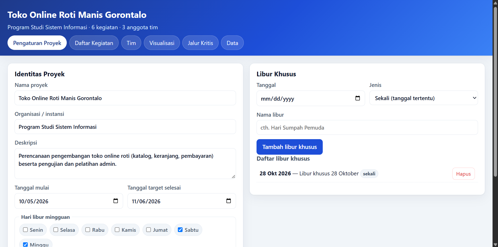
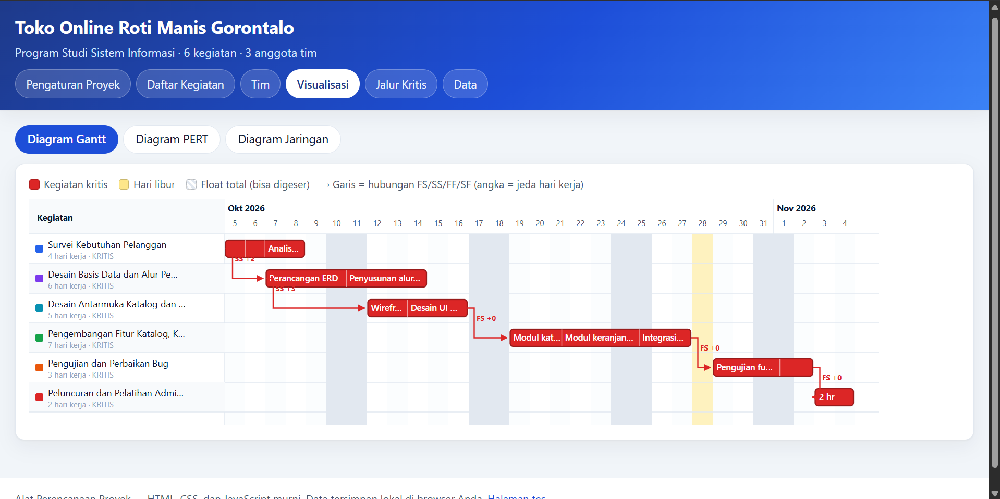

# Alat Perencanaan Proyek

Alat perencanaan proyek berbasis web untuk mata kuliah/mahasiswa **Sistem Informasi**.
Dibangun murni dengan **HTML, CSS, dan JavaScript** — tanpa framework, tanpa proses build,
tanpa server. Semua data disimpan di `localStorage` browser.

---

## Cara Menjalankan

1. Buka folder ini di penjelajah berkas.
2. **Klik dua kali `index.html`** — aplikasi langsung terbuka di browser (Chrome, Firefox, Edge).
   Tidak perlu `npm install`, tidak perlu `localhost`, tidak perlu internet.

Alternatif (bila browser membatasi akses berkas `file://`):

```bash
# Python 3
python -m http.server 8000
# lalu buka http://localhost:8000/index.html
```

### Menjalankan tes otomatis

**Cara 1 — browser (disarankan):** buka **`tes.html`**. Seluruh pemeriksaan dijalankan otomatis
dan hasilnya ditampilkan di halaman (hijau = lulus, merah = gagal). Tombol *Jalankan ulang tes*
tersedia di kop halaman.

**Cara 2 — Node.js** (tanpa browser):

```bash
node tes.js
```

Keluaran dicetak ke konsol; kode keluar `0` bila semua tes lulus, `1` bila ada yang gagal.

---

## Struktur Berkas

| Berkas       | Fungsi |
|--------------|--------|
| `index.html` | Halaman utama aplikasi (6 tab: Pengaturan Proyek, Daftar Kegiatan, Tim, Visualisasi, Jalur Kritis, Data). |
| `style.css`  | Seluruh gaya (termasuk gaya halaman tes). |
| `hitung.js`  | **Logika perhitungan terpisah** (tanpa DOM): kalender kerja, penjadwalan maju-mundur, float total, jalur kritis, enumerasi semua jalur awal→akhir. Dapat dipakai di browser (`window.Hitung`) maupun Node (`require`). |
| `contoh.js`  | Dua data contoh siap muat (`Contoh.rotiManis()`, `Contoh.kasir()`), dipakai tombol **Muat contoh** dan halaman tes. |
| `app.js`     | Lapisan antarmuka: state + `localStorage`, ekspor/impor JSON, formulir, tabel, dan rendering Gantt/PERT/jaringan. |
| `tes.html`   | Halaman tes otomatis (menjalankan seluruh pemeriksaan di browser). |
| `tes.js`     | Logika tes: juga bisa dijalankan dengan `node tes.js`. |
| `README.md`  | Berkas ini. |

---

## Fitur

### 1. Pengaturan proyek
Nama, organisasi, deskripsi, tanggal mulai, tanggal target selesai, **hari libur mingguan**
(pilih Senin–Minggu), serta **daftar libur khusus** dengan tiga jenis:
`sekali` (tanggal tertentu), `tahunan` (setiap tahun pada tanggal yang sama), dan
`bulanan` (setiap bulan pada tanggal yang sama). Ada juga opsi **menggunakan libur pribadi
anggota** dalam perhitungan jadwal.

### 2. Daftar kegiatan
Tambah/ubah/hapus kegiatan dengan **durasi hari kerja**, **warna bar**, dan **sub-kegiatan**.
Hubungan antar kegiatan mendukung empat tipe dengan **jeda hari**:

| Tipe | Arti |
|------|------|
| `FS` | *Finish-to-Start* — penerus mulai **setelah** pendahulu selesai (+ jeda) |
| `SS` | *Start-to-Start* — penerus mulai bersamaan dengan pendahulu (+ jeda) |
| `FF` | *Finish-to-Finish* — penerus selesai bersamaan dengan pendahulu (+ jeda) |
| `SF` | *Start-to-Finish* — penerus selesai bersamaan dengan pendahulu mulai (+ jeda) |

Jadwal dihitung ulang **otomatis setiap perubahan**, melewati hari libur mingguan dan libur
khusus. Kegiatan dengan siklus dependensi akan dilaporkan (perhitungan dihentikan dengan pesan).

### 3. Tim
Daftar anggota (nama, peran, kontak, **libur pribadi**) dan **penugasan** anggota ke kegiatan.

### 4. Visualisasi
- **Diagram Gantt** — bar per kegiatan (sub-kegiatan ditampilkan sebagai segmen di dalam bar),
  kolom tanggal yang menandai akhir pekan/libur, **garis dependensi** berlabel tipe + jeda,
  bar bertanda kritis berwarna merah, dan kotak putus-putus sebagai **float total**.
- **Diagram PERT** — kotak per kegiatan berisi *mulai awal, selesai awal, mulai akhir,
  selesai akhir, float total*, disusun menurut tanggal mulai awal.
- **Diagram jaringan** — graf ketergantungan berjenjang dengan panah berlabel
  hubungan (mis. `FS +0`, `SS +2`).

### 5. Jalur kritis
- Ringkasan: estimasi lama proyek (hari kerja), tanggal mulai–selesai, perbandingan dengan
  target, jumlah jalur, dan jumlah kegiatan kritis.
- **Tabel semua jalur awal → akhir** beserta total durasi tiap jalur; **jalur terpanjang
  ditandai merah** sebagai jalur kritis.
- Tabel waktu kegiatan: mulai/selesai awal, mulai/selesai akhir, float total, status.

### 6. Data
- **Ekspor JSON** — unduh seluruh data sebagai berkas `.json`.
- **Impor JSON** — muat kembali berkas hasil ekspor (divalidasi dahulu).
- **Muat contoh 1** dan **Muat contoh 2** (menimpa data yang ada), serta **Hapus semua data**.
- Pratinjau JSON langsung di halaman.

---

## Dua Contoh Bawaan

### Contoh 1 — Toko Online “Roti Manis Gorontalo”
- Mulai **5 Okt 2026**, rencana sampai **6 Nov 2026**; libur akhir pekan (Sabtu–Minggu)
  dan **28 Okt 2026** sebagai libur khusus.
- Kegiatan: Survei Kebutuhan Pelanggan (4) → Desain Basis Data (6, SS jeda 2) →
  Desain Antarmuka (5, SS jeda 3) → Pengembangan Fitur (7, FS jeda 0) →
  Pengujian (3, FS jeda 0) → Peluncuran (2, FS jeda 0).
- Hasil perhitungan: selesai **4 Nov 2026** (22 hari kerja), seluruh kegiatan berada di
  jalur kritis karena dependensi `SS` berantai.

### Contoh 2 — Jalur kritis aplikasi kasir dan stok toko
A=2, B=3, C=1 (tanpa pendahulu); D=4 (A); E=6 (B); F=5 (B); G=9 (C); H=14 (D,E);
I=3 (G); J=2 (F,H,I) — semua dependensi `FS +0`.

Empat jalur awal→akhir ditemukan: **B–E–H–J = 25 hari (jalur kritis, ditandai merah)**,
A–D–H–J = 22, C–G–I–J = 15, B–F–J = 10. Estimasi lama proyek = **25 hari kerja**
(5 Jan 2026 → 6 Feb 2026, melewati akhir pekan).

---

## Catatan Teknis

- **Durasi selalu dalam hari kerja.** Hari libur dilewati saat penjadwalan, bukan saat input.
- **Tipe berkas:** tanpa modul ES (semua berkas memakai skrip biasa + pola UMD),
  sehingga aplikasi tetap berjalan langsung dari `file://`.
- **Penyimpanan:** kunci `perencanaan-proyek.v1` di `localStorage`. Kunjungan pertama akan
  memuat Contoh 1 secara otomatis.
- Karena dependensi `SS`/`FF` membuat kegiatan **tumpang tindih**, jumlah total durasi jalur
  bisa **lebih besar** daripada lama proyek (Contoh 1: total jalur 27 hari, lama proyek
  22 hari kerja). Lama proyek dihitung dari jadwal, bukan dari jumlah durasi.
- Jumlah jalur dibatasi 20.000 entri untuk proyek dengan graf dependensi yang sangat ramai.

---

## Pengujian

`tes.js` menjalankan 47 pemeriksaan otomatis:

1. **Contoh 1** — tanggal mulai/setiap kegiatan, pelewatan akhir pekan dan libur 28 Okt,
   tanggal selesai proyek, lama 22 hari kerja, jumlah/total jalur, status kritis seluruh
   kegiatan, dan pengaruh aktivasi libur pribadi anggota.
2. **Contoh 2** — jumlah jalur (4), total tiap jalur (25/22/15/10), penandaan jalur
   kritis B–E–H–J, kegiatan ber-float-0 (B, E, H, J), estimasi lama 25 hari kerja,
   serta float sejumlah kegiatan non-kritis.
3. **Kasus tambahan** — perilaku `FS`/`SS`/`FF`/`SF` + jeda, pelewatan libur khusus,
   dan deteksi siklus dependensi.

## Tampilan Antarmuka (UI) Aplikasi
 


